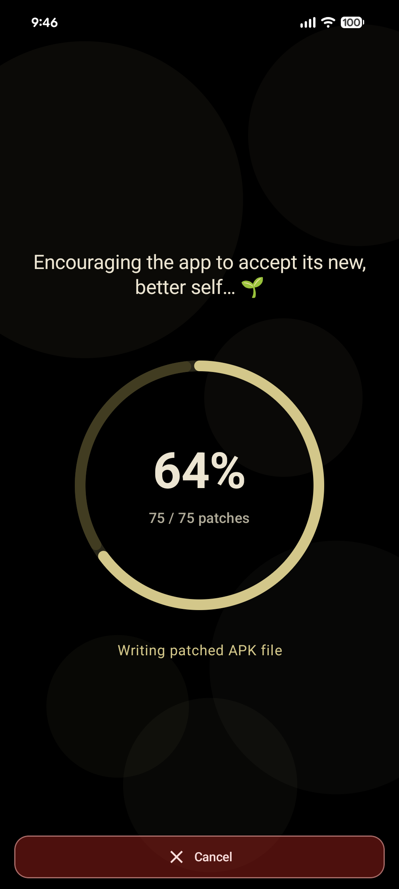

<h2 align=center>Morphe Manager</h2>
<h3 align=center>A Modern Patcher For Android Apps</h3>

    
Warning!

- Some Morphe mods are piracy! (such as removing ads without paying for a premium service) Privacy is illegal!

### What is Morphe?

- Morphe is a modern alternative to Morphe for Android that patches other apps, giving you features that otherwise wouldn't be available. Morphe has a large yet still growing collection of supported apps, ranging from YouTube all the way to Amazon.
    - Morphe does provide paid features too, like letting you completely disable Ads on YouTube

### How do I get Morphe?

- It's easy! You just download the APK from their official site or their GitHub and then give the app permissions!
    - [Morphe Site](https://morphe.software/)
    - [Morphe GitHub](https://github.com/MorpheApp/)
